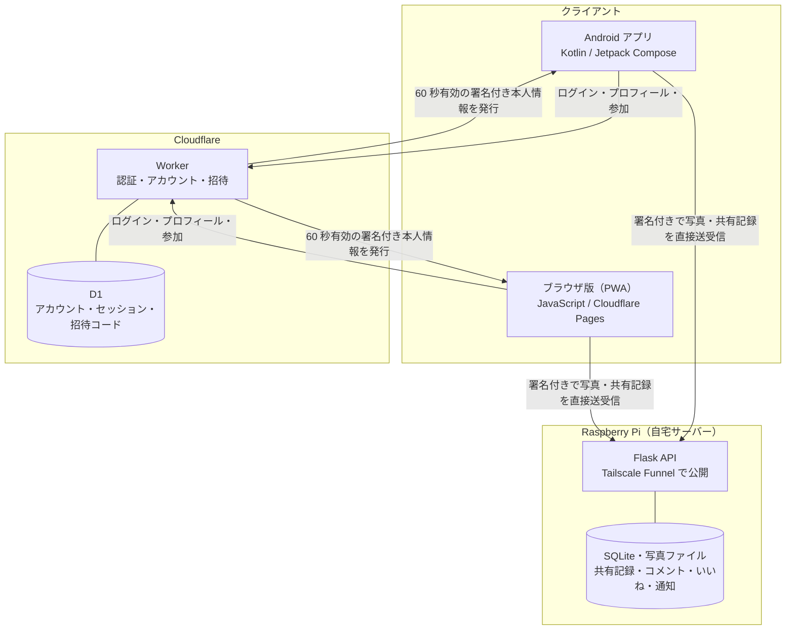

# Biodiary — 自然観察アルバム

Biodiary は、身近な生きものの写真に撮影場所や分類情報を添えて記録し、地図と図鑑で振り返ることができる自然観察アルバムです。Android アプリとブラウザ版（PWA）の 2 つのクライアントを提供しており、招待制のコミュニティ内で観察記録を共有し、コメントやいいねで交流できます。

- 公開サイト（ブラウザ版）：https://biodiary-album.pages.dev/
- 現在のバージョン：ver0.1.3（2026 年 10 月公開）、2026 年 11 月に複数コミュニティへ対応

---

## 開発体制

個人で開発しています。**コードの実装は AI コーディングエージェント（OpenAI Codex、Claude Code）に任せています。**

・企画と、作る機能・画面の決定
・システム構成や仕様の判断（どこに何を保存するか、どの方式を採るか）
・AI への作業指示と、提案された変更内容の確認
・実機（Android 端末・ブラウザ）での動作確認と不具合の報告
・Cloudflare・Raspberry Pi へのデプロイと、サーバーの運用

に関しては私が主に関わっています。

---

## 主な機能

| 分類 | 内容 |
|---|---|
| 観察の記録 | 写真（1 件につき最大 4 枚）、名前、撮影日時、場所、コメント、ジャンルを登録。写真の位置情報（EXIF）から撮影地点を自動設定 |
| 地図 | OpenStreetMap 上に写真ピンを表示。季節・タグ・投稿者・いいね済みなどの条件で絞り込み |
| 図鑑 | ジャンル別の一覧表示。新しい順・古い順・五十音順の並び替え。同名の投稿はいいね数の多いものを代表写真として表示 |
| 分類情報 | 種・属・科・目を GBIF（地球規模生物多様性情報機構）の API から検索し、自動入力 |
| コミュニティ | 招待コードによる参加、メンバー一覧、プロフィールカード、コメント・返信、いいね、通知 |
| プライバシー | 場所を非公開にした記録は県庁所在地の座標で表示し、共有写真から位置情報を除去 |
| 複数コミュニティ | 招待コードごとに参加先のコミュニティを指定でき、投稿・メンバー・通知をコミュニティ単位で分離 |

---

## システム構成



役割を次のように分けています。

- **Cloudflare Worker + D1**：アカウント登録、ログイン、セッション、コミュニティへの参加と招待コードを管理します。常時稼働が必要で、写真のような大きなデータを持たない処理を担当します。
- **Raspberry Pi**：写真と共有記録、コメント・いいね・通知を保存します。容量が大きいデータを無料枠の制約なく保存するため、自宅のサーバーで運用しています。
- **端末**：まだ共有していない観察記録は端末内にのみ保存します。

---

## 技術スタック

| 領域 | 使用技術 |
|---|---|
| Android | Kotlin 2.2、Jetpack Compose（Material 3）、Coil、ExifInterface、Kotlin Coroutines、WebView + Leaflet（地図）。minSdk 26 / targetSdk 36 |
| ブラウザ版 | JavaScript（フレームワーク不使用）、IndexedDB、Service Worker（PWA）、Leaflet。Cloudflare Pages で配信 |
| 認証 API | Cloudflare Workers、Cloudflare D1（SQLite 互換）、Web Crypto API、Wrangler |
| 写真・共有 API | Python、Flask、Waitress、SQLite、systemd、Tailscale Funnel |
| 外部データ | OpenStreetMap（地図タイル）、GBIF API（分類情報） |

---

## 設計上の工夫

### 1. 認証と写真保存の分離（署名付きチケット方式）

当初は Worker が写真の通信を Raspberry Pi へ中継する構成でしたが、Worker から Tailscale Funnel への接続で TLS エラー（HTTP 525）が発生しました。そこで、Worker は写真を中継せず、**「誰が・どのコミュニティに属しているか」を記した 60 秒間有効の署名（HMAC-SHA256）**だけを発行し、端末がその署名を添えて Pi へ直接接続する方式に変更しました。Pi は共有の秘密鍵で署名と有効期限を検証してから応答します。

これにより、アカウント情報を Pi に持たせずに済み、Pi 側は「署名が正しいか」を確かめるだけの単純な構成になりました。

### 2. アプリを改修せずに複数コミュニティへ対応

面接・見学用に、既存メンバーの投稿と混ざらない別コミュニティが必要になりました。もともとコミュニティ名の表示や管理者による名前変更の画面はあったため、**変更はサーバー側に限定し、Android アプリの再配布を不要にしました**。

- 招待コードに参加先のコミュニティ ID を持たせ、参加時にアカウントへ記録（D1 マイグレーションで既存アカウントは `default` に移行）
- Worker が発行する署名にコミュニティ ID を追加
- Pi 側では「共有記録は同じコミュニティの投稿者のものだけ」を SQL の共通条件として、一覧・詳細・写真・コメント・いいね・通知のすべてに適用
- 署名にコミュニティ ID を含まない旧版の Worker からの要求は `default` として扱い、段階的に更新できるようにした

反映の順序にも注意しました。旧版の Pi のまま新しい Worker を公開すると、別コミュニティのメンバーに既存の投稿が見えてしまうため、**Pi → データベース → Worker** の順で更新する手順を定めています。

### 3. セキュリティ

- パスワードはソルトとサーバー側の秘密値（ペッパー）を加えた HMAC で保存し、比較は定数時間で行う
- セッショントークン・招待コードはハッシュ値のみを保存し、データベースから元の値を復元できない
- 登録は IP ごとに 1 日 5 回、ログイン失敗は 15 分間に 8 回までに制限
- 招待コードは 1 回限り・14 日間有効。定員超過時はコードを未使用に戻す
- アップロードされた画像は形式（JPEG・PNG・WebP）とサイズを検証
- 秘密鍵は Wrangler の Secret と Pi の環境変数で管理し、ソースコードには含めない

### 4. 位置情報のプライバシー

希少な生きものや自宅周辺の撮影地点が特定されないよう、場所を非公開にした記録は都道府県の県庁所在地の座標に置き換えて共有し、写真の EXIF に含まれる位置情報も除去します。

---

## リポジトリ構成

| フォルダ | 内容 |
|---|---|
| [`Biodiary-Android`](Biodiary-Android/README.md) | Android アプリ（Gradle プロジェクト） |
| [`Biodiary-Android/server`](Biodiary-Android/server/README.md) | Raspberry Pi 用の写真・共有 API（Flask）とテスト |
| [`Biodiary-Web`](Biodiary-Web/README.md) | ブラウザ版（静的ファイル一式） |
| [`Biodiary-Cloudflare`](Biodiary-Cloudflare/README.md) | Cloudflare Worker、D1 マイグレーション、招待コード発行スクリプト |
| [`CHANGELOG.md`](CHANGELOG.md) | 更新履歴 |

各フォルダの README に、それぞれの構成と技術的な詳細を記載しています。Worker や写真サーバーの URL など環境ごとの値はリポジトリに含めず、見本ファイル（`wrangler.example.toml`、`config.example.js`）と `local.properties` で設定する方式にしています。

Android アプリの内部 ID（パッケージ名 `jp.morinote.app`）は、開発初期の仮称「MoriNote」の名残です。インストール済みのアプリを更新できるよう、あえて変更していません。

---

## テスト

Raspberry Pi API のテスト（複数写真の保存、コミュニティ間の分離など）は次のコマンドで実行できます。一時ディレクトリのデータのみを使用します。

```sh
cd Biodiary-Android/server
pip install flask waitress pillow
python3 -m unittest discover -s tests
```

---

## 開発の経緯

| バージョン | 時期 | 主な内容 |
|---|---|---|
| ver0.1.0 | 2026 年 10 月 6 日 | 観察の登録、地図、図鑑、タグ、GBIF 検索（端末内保存のみ） |
| ver0.1.1 | 2026 年 10 月 7 日 | ブラウザ版の公開、招待制コミュニティ、写真の共有・同期 |
| ver0.1.2 | 2026 年 10 月 10 日 | Cloudflare による認証へ移行、署名付き直接接続、複数写真、位置情報の非公開化 |
| ver0.1.3 | 2026 年 10 月 11 日 | コメント・いいね・通知、プロフィールカード、初回ガイド |
| — | 2026 年 11 月 | 複数コミュニティへの対応 |

詳細は [CHANGELOG.md](CHANGELOG.md) を参照してください。

---

## 今後の課題

- 写真サーバーが自宅の Raspberry Pi 1 台であるため、停止時に共有機能が使えない。オブジェクトストレージ（Cloudflare R2 など）への移行を検討
- 運営者向けの管理画面（登録者の一覧・招待コードの発行など）がなく、データベースを直接操作している
- Android アプリの画面処理が 1 ファイルに集中しており、画面ごとの分割と自動テストの追加が必要
